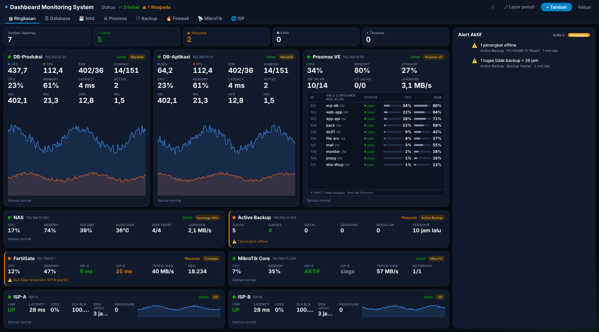
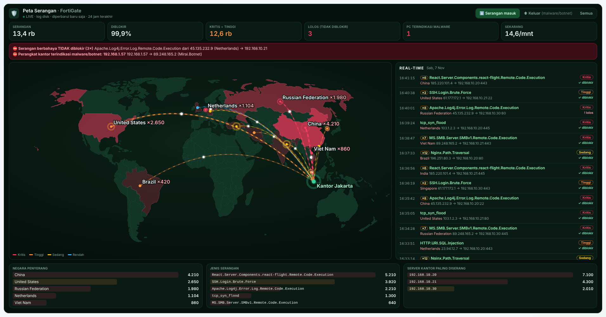

# Dashboard Monitoring System

Aplikasi web untuk memantau **database** (MariaDB, PostgreSQL, SQL Server, SQLite), **server Proxmox VE**, **Proxmox Backup Server**,
**NAS Synology**, **Active Backup for Business**, **FortiGate**, **MikroTik**, dan **SLA ISP** secara real-time, dengan tema terang/gelap,
tab per kategori, dan tampilan 4 panel satu layar.



> **Mulai di sini**
> - 📘 **[Tutorial instalasi dari GitHub](docs/TUTORIAL.md)** — langkah demi langkah sampai dashboard berjalan otomatis
> - 📄 **[Panduan lengkap (PDF)](docs/Panduan-Dashboard-Monitoring-System.pdf)** — cara menambah setiap perangkat, membaca dashboard, alert, laporan, akses dari luar, mengatasi masalah

---

## Mulai cepat

Tidak perlu mengisi konfigurasi apa pun. Kunci enkripsi dan password login dibuat otomatis
saat pertama kali dijalankan.

### Opsi A — Docker (paling mudah)

```bash
docker compose up -d --build
docker compose logs dbmon        # cari baris "Password login (dibuat otomatis)"
```

Buka `http://localhost:3000`, masuk dengan password tersebut, lalu tekan **+ Tambah database**.
Dari HP (Wi-Fi yang sama): `http://<IP-komputer>:3000`.

Ingin langsung melihat grafik bergerak? Jalankan beserta database demo:

```bash
docker compose --profile demo up -d --build
```

Lalu daftarkan di form:

| Engine | Host | Port | Username | Password |
|---|---|---|---|---|
| MariaDB | `demo-mariadb` | 3306 | `root` | `demo123` |
| PostgreSQL | `demo-postgres` | 5432 | `postgres` | `demo123` |

Catatan Docker:
- Database yang berjalan **di komputer yang sama** (bukan di container): isi Host
  `host.docker.internal`, bukan `localhost`.
- SQLite: taruh file `.db` di folder `./sqlite`, lalu di form cukup isi nama filenya.
- Lupa password login: `docker compose exec dbmon cat /app/data/admin-password.txt`.
- Atur password sendiri: buat file `.env` di folder ini berisi `DBMON_ADMIN_PASSWORD=...`,
  lalu `docker compose up -d`.
- Data (daftar koneksi, `master.key`) tersimpan di volume `dbmon-data`. Jangan hapus volume
  itu: tanpa `master.key`, password DB yang tersimpan tidak bisa dibuka lagi.

### Opsi B — Tanpa Docker (butuh Node.js 22.13+, disarankan versi LTS terbaru)

```bash
./start.sh          # Linux / macOS
start.bat           # Windows (klik dua kali)
```

Skrip menginstal paket, mem-build frontend & backend (hanya pada jalankan pertama), lalu
menyalakan server di port 3000. Alamat untuk HP dan password login tercetak di terminal.
Password juga tersimpan di `backend/data/admin-password.txt`.
Setelah memperbarui kode, jalankan `./start.sh --rebuild`.

Jika jendela langsung tertutup atau server berhenti, pesan errornya tetap tampil di jendela
dan juga disimpan di `backend/data/error.log`. Penyebab paling umum: port 3000 sudah dipakai
program lain (ganti dengan `set PORT=3001` di bagian atas `start.bat`).

#### Menu server & jalan otomatis (Windows) — disarankan

Klik dua kali **`menu.bat`** (otomatis meminta izin administrator):

| Pilihan | Fungsi |
|---|---|
| 1 | **Pasang jalan otomatis**: server berjalan di latar belakang (tanpa jendela, akun SYSTEM) dan menyala sendiri setiap Windows hidup, walau belum ada yang login. Bila berhenti, dinyalakan ulang otomatis. Port dibuka di Windows Firewall. |
| 2 | Hapus jalan otomatis |
| 3 / 4 | Nyalakan ulang / hentikan server latar |
| 5 | **Update**: setelah menimpa folder dengan versi baru, pilih ini (build ulang + nyalakan kembali) |
| 6 / 7 | Buka dashboard / lihat log (`backend\data\server.log`) |
| 8 | Ganti port (port terbaca dari `set PORT=` di `start.bat` bila ada) |
| 9 | Reset password login bila lupa |
| T | Jalankan di jendela menu (untuk mencoba / melihat error) |

Setelah jalan otomatis dipasang, `start.bat` tidak perlu dipakai lagi (bila dijalankan
bersamaan akan bentrok port).

Tidak ada modul native yang perlu di-compile: SQLite memakai modul bawaan Node.js
(`node:sqlite`), sehingga Python atau Visual Studio Build Tools tidak diperlukan.

### Pengaturan (opsional)

Semua lewat environment variable atau file `.env` (contoh lengkap: `backend/.env.example`):

| Variabel | Default | Fungsi |
|---|---|---|
| `DBMON_ADMIN_PASSWORD` | dibuat otomatis | Password login dashboard |
| `DBMON_ALLOWED_HOSTS` | kosong (semua) | Allowlist host DB, mis. `10.0.1.*,db.internal,*.corp.local` |
| `DBMON_INTERVAL_MS` | `1000` | Interval polling metrik |
| `DBMON_SESSION_HOURS` | `12` | Lama sesi login biasa |
| `DBMON_REMEMBER_DAYS` | `30` | Lama login bila **Ingat saya** dicentang (diperpanjang otomatis selama dipakai) |
| `DBMON_HISTORY_MINUTE_DAYS` | `31` | Riwayat detail per menit |
| `DBMON_HISTORY_DAYS` | `400` | Riwayat per jam & riwayat alert (untuk laporan bulanan/tahunan) |
| `DBMON_SQLITE_DIR` | kosong (Docker: `/sqlite`) | Batasi lokasi file SQLite |
| `DBMON_SECURE_COOKIE` / `DBMON_TRUST_PROXY` | kosong | Tidak perlu untuk Cloudflare Tunnel di komputer yang sama (otomatis). Isi `1` hanya bila reverse proxy berada di komputer lain |
| `PORT` | `3000` | Port aplikasi (Docker: `DBMON_PORT`) |

### User monitoring yang disarankan

Gunakan user khusus dengan hak minimum, bukan root/sa:

```sql
-- MariaDB
CREATE USER 'dbmon'@'%' IDENTIFIED BY 'ganti-password';
GRANT PROCESS ON *.* TO 'dbmon'@'%';

-- PostgreSQL
CREATE USER dbmon WITH PASSWORD 'ganti-password';
GRANT pg_monitor TO dbmon;

-- SQL Server
CREATE LOGIN dbmon WITH PASSWORD = 'Ganti-Password1!';
GRANT VIEW SERVER STATE TO dbmon;
```

---

## Server, NAS, Backup, Firewall, MikroTik & ISP

Tambah lewat tombol **+ Tambah** → pilih jenis. Semua jenis tampil di tab masing-masing
(Ringkasan · Database · Proxmox · NAS · Backup · Firewall · MikroTik · ISP); tab **Ringkasan** berisi status semua sumber
dan seluruh alert aktif. Tombol ☀/☾ di kanan atas mengganti tema terang/gelap (tersimpan per browser).

| Jenis | Yang dibutuhkan | Yang dipantau |
|---|---|---|
| **Proxmox VE** | API token: Datacenter → Permissions → API Tokens → Add (hapus centang *Privilege Separation*), lalu beri role **PVEAuditor** di path `/`. Isi Token ID `user@pve!nama` + secret. Port 8006. | CPU, RAM, storage, jaringan, IO wait; daftar VM/CT, node & storage; alert node offline, VM berhenti, storage penuh |
| **Proxmox Backup Server** | API token: Configuration → Access Control → API Token → Add, lalu Permissions → Add → **API Token Permission** path `/` role **Audit**. Isi Token ID `user@pbs!nama` + secret. Port 8007. Tampil di tab **Backup**. | CPU, RAM, datastore (% terisi & perkiraan penuh), backup terakhir tiap VM/CT, tugas 24 jam (backup, verifikasi, prune, GC, sync); alert backup gagal, VM/CT tidak dibackup > 26 jam, tugas gagal, datastore penuh |
| **NAS Synology** | Akun khusus anggota grup **administrators**, **tanpa 2FA**. Port 5001 (https) / 5000 (http). | CPU, RAM, jaringan, volume & storage pool, disk (status, S.M.A.R.T., suhu); alert volume degraded/penuh, disk bermasalah/panas |
| **Active Backup for Business** | Akun NAS yang sama (login dipakai bersama dengan panel NAS). | Semua tugas backup: hasil terakhir (sukses/sebagian/gagal/berjalan), waktu, durasi, data, perangkat offline; alert gagal & tidak backup > 26 jam |
| **FortiGate** | REST API Admin: System → Administrators → Create New → **REST API Admin**, profil hanya-baca (termasuk **Log & Report: Read** untuk Peta Serangan), **Trusted Hosts** = IP komputer Dashboard. Isi API key. Port HTTPS admin (bawaan 443). VDOM opsional. | CPU, memory, sesi, trafik WAN, **latency/jitter/loss per ISP dari SD-WAN Performance SLA**, interface, tunnel IPsec, **🛡 Peta Serangan** (serangan masuk & perangkat kantor yang terinfeksi, dari log IPS/DoS/antivirus); alert link WAN putus, SLA tidak terpenuhi, VPN putus, serangan lolos, PC terinfeksi, CPU/memory tinggi |
| **MikroTik** | RouterOS **v7.1+** (REST API). Aktifkan IP → Services → **www** (port 80) atau **www-ssl** (443), batasi *Available From* ke IP Dashboard, buat user grup **read**. | CPU, memory, suhu, trafik WAN, **jalur ISP aktif (default route) & failover**, Netwatch, interface, klien DHCP; alert WAN putus, failover, Netwatch down, suhu/CPU tinggi |
| **ISP (SLA)** | IP yang mewakili link (gateway/modem ISP atau IP publik link), bisa di-ping dari komputer Dashboard Monitoring System. Target SLA, mis. 99,5%. | Ping tiap 10 dtk: status UP/DOWN, latency, jitter, packet loss; uptime 24 jam/7 hari/30 hari/bulan ini/bulan lalu, sisa jatah downtime, riwayat gangguan |

Catatan:
- **SLA ISP**: gangguan dihitung bila ≥ 3 ping gagal berturut-turut (paket hilang sesekali bukan downtime).
  Waktu ketika Dashboard Monitoring System sendiri mati tidak dihitung sebagai downtime ISP. Data SLA disimpan 400 hari
  (`data/isp.sqlite`). Bila ping diblokir, pilih metode **Cek port TCP** dengan port yang terbuka (mis. 443/53).
- **Synology**: bila password salah, Dashboard Monitoring System menunggu 5 menit sebelum mencoba lagi agar IP komputer
  tidak diblokir fitur Auto Block DSM.
- **Active Backup for Business**: API-nya tidak didokumentasikan resmi oleh Synology; data dibaca mengikuti
  pustaka komunitas. Bila ada angka yang tidak sesuai, buka menu **⋯ → Lihat data mentah** pada panelnya,
  salin isinya, dan kirimkan untuk penyesuaian.
- **Dua ISP di belakang FortiGate**: cara paling akurat adalah membaca **SD-WAN Performance SLA** lewat panel FortiGate
  (FortiGate sendiri mem-ping lewat tiap link). Bila memakai panel ISP (ping dari komputer Dashboard), buat
  Policy Route per IP tujuan agar tiap target keluar lewat ISP-nya masing-masing.
- **MikroTik dual ISP**: beri *comment* pada default route (mis. `ISP-A`) agar nama jalur tampil rapi;
  route dengan distance terkecil dianggap jalur utama, dan alert failover muncul bila route cadangan yang aktif.
- Proxmox, Synology, FortiGate & MikroTik (www-ssl) memakai sertifikat self-signed bawaan → diterima otomatis (hanya untuk koneksi itu).

---

## 🛡 Peta Serangan (FortiGate)



Tab **Firewall → 🛡 Peta Serangan** menampilkan serangan **nyata ke jaringan kantor** (bukan data global),
diambil dari log FortiGate setiap 30 detik:

- Peta dunia dengan garis serangan beranimasi dari **negara asal** ke kantor (warna = tingkat bahaya).
- Daftar **real-time**: jam, nama serangan, ×jumlah, tingkat, negara & IP asal → server tujuan, diblokir/lolos.
- Filter **Serangan masuk / Keluar (malware/botnet dari PC kantor) / Semua**.
- Peringkat negara penyerang, jenis serangan, server paling diserang, PC terindikasi.
- Alert: serangan kritis/tinggi **tidak diblokir**, **PC kantor terindikasi malware/botnet**, lonjakan serangan.
- Riwayat 90 hari, ikut masuk laporan (PDF & CSV).

Syarat di FortiGate: profil admin API **Log & Report: Read**, logging ke **Disk** atau **Memory**, dan
**IPS** (plus Antivirus bila berlisensi) aktif di policy internet → server kantor dan LAN → internet dengan
*Log Allowed Traffic: Security Events*. Lokasi negara berasal dari database GeoIP FortiGate (tingkat negara).
Peta dunia: data public domain dari [world.geo.json](https://github.com/johan/world.geo.json), dibundel di aplikasi (tanpa internet).

---

## Login, password & laporan

- **Ingat saya** (di layar login, tercentang bawaan): cukup sekali memasukkan password per perangkat;
  login bertahan 30 hari dan diperpanjang otomatis selama dashboard dipakai. Browser juga akan
  menawarkan menyimpan password.
- **Ganti password**: tombol ⚙ di kanan atas → *Ganti password*. Semua perangkat lain otomatis keluar.
  Password baru disimpan sebagai hash di `backend/data/admin-password.hash` (file teks lama dihapus).
- **Lupa password**: `menu.bat` → 9, atau hapus `backend/data/admin-password.hash` lalu jalankan ulang
  server; password acak baru tercetak dan tersimpan di `admin-password.txt`.

### Riwayat & laporan (tab 📄 Laporan)

- Riwayat disimpan otomatis: **per menit 31 hari**, **per jam ±13 bulan**, plus **riwayat alert**
  (kapan muncul, seberapa parah, kapan pulih). Grafik di tiap tab kini bisa 7 hari & 30 hari.
- Tab **Laporan**: pilih periode (hari ini, kemarin, 7/30 hari, bulan ini, bulan lalu, atau tanggal
  bebas) dan sumber. Tampil ringkasan per sumber: rata-rata & puncak, total query, data terpantau,
  lama terputus, SLA ISP & gangguan, serta daftar alert.
- **🖨 Cetak / Simpan PDF**: cetak langsung atau pilih printer *Save as PDF*.
- **⬇ Unduh CSV**: data per jam / per hari / per menit (maks. 7 hari) untuk Excel. Pilih format
  *Excel Indonesia* (`;` dan koma desimal) atau *Excel English*.

---

## Akses dari luar kantor (domain + Cloudflare Tunnel)

Tanpa VPN, tanpa membuka port di router/firewall: `cloudflared` di komputer dashboard membuat
koneksi keluar ke Cloudflare, lalu `https://monitor.domainanda.com` diteruskan ke `http://localhost:<PORT>`.

1. Domain sudah memakai DNS Cloudflare.
2. Dashboard Cloudflare → **Networking → Tunnels → Create a tunnel** → beri nama → pilih **Windows** →
   jalankan perintah yang ditampilkan (CMD *Run as administrator*). cloudflared terpasang sebagai
   service Windows dan ikut menyala otomatis.
3. Di tunnel tersebut: **Routes → Add route → Published application** → Subdomain `monitor`, Domain
   `domainanda.com`, Service URL `http://localhost:3000` (sesuaikan dengan port dashboard).
4. **Sangat disarankan**: lindungi dengan **Cloudflare Access** (Zero Trust → Access → Applications →
   Self-hosted, domain `monitor.domainanda.com`, policy *Allow* email-email tertentu dengan
   One-time PIN). Pengunjung harus memasukkan kode dari email sebelum halaman login dashboard
   terlihat, jadi orang asing tidak bisa mencoba-coba password.
5. Matikan **Rocket Loader** untuk domain ini (Speed → Optimization) agar skrip dashboard tidak diubah.

Yang sudah ditangani aplikasi:
- Cookie login otomatis diberi flag **Secure** bila diakses lewat HTTPS (Cloudflare), dan tetap
  berfungsi lewat `http://IP:port` di LAN/VPN.
- IP asli pengunjung dibaca dari header Cloudflare **hanya** bila koneksi datang dari komputer itu
  sendiri (cloudflared), sehingga tidak bisa dipalsukan dari LAN.
- Login gagal: maks. 10× per IP per 15 menit, setiap kegagalan diperlambat; bila ada > 40 kegagalan
  dari internet dalam 15 menit, login **dari luar** dikunci sementara tetapi login dari kantor/VPN
  tetap bisa. Login dari luar tercatat di log server.
- WebSocket real-time berjalan lewat tunnel tanpa pengaturan tambahan.
- ⚙ Pengaturan menampilkan cara akses saat ini (Cloudflare / kantor) dan tombol
  **Keluarkan semua perangkat lain**.

Sebelum dibuka ke internet: ganti password admin menjadi password yang kuat (⚙ → Ganti password).

---

## Isi setiap panel database

| Bagian | Isi | Sumber |
|---|---|---|
| 1. CPU Usage | % CPU server database | **Monitoring Agent** (lihat di bawah) |
| 2. Memory Usage | % RAM server database (arahkan kursor: GB terpakai) | Monitoring Agent |
| 3. Koneksi | total koneksi / `max_connections` | database |
| 4. Read/Write Ops | read = SELECT/dtk, write = INSERT+UPDATE+DELETE/dtk (SQL Server: halaman I/O) | database |
| 5. QPS · 6. TPS | query/dtk (biru) · transaksi/dtk (oranye) | database |
| Throughput | judul QPS biru = batang, TPS oranye = garis; SEL · INS · UPD · DEL per detik di header | database |
| Query Latency | rata-rata & maksimum (ms) | database |
| Top 5 Slow Queries | query terlambat | database / pengamatan Dashboard Monitoring System |
| Sesi Aktif & Lock | query yang sedang berjalan, sesi yang menunggu/diblok lock | database |
| Alert | CPU/RAM/disk tinggi, koneksi hampir penuh, query > 30 dtk, lock > 10 dtk, latency tinggi, koneksi/agen putus | Dashboard Monitoring System |

**Rentang waktu** (kanan atas): Live 5 menit (per detik), 15 menit, 1 jam, 6 jam, 24 jam.
Riwayat diringkas per menit dan disimpan 8 hari di `data/metrics.sqlite`.

**Tata letak**: 1 database penuh layar, 2 berdampingan, 3–4 grid 2×2 tanpa scroll; lebih dari 4 →
2 baris per layar (scroll). Dropdown database untuk menampilkan satu database saja. Pada layar pendek
(mis. laptop 1366×768) panel otomatis memakai **mode ringkas**: Alert, Sesi & Slow query jadi tab di
samping grafik. Pakai tombol **Layar penuh** untuk ruang maksimal.

### Monitoring Agent (CPU & RAM asli)

Database tidak menyediakan CPU & RAM server lewat SQL, jadi dipasang agen kecil di **server database**
(folder `agent/`, satu file, tanpa `npm install`, cukup Node.js 18+):

1. Salin folder `agent` ke server database.
2. Windows: klik dua kali `menu-agent.bat` → pilih **1 Pasang jalan otomatis** (agen jalan di latar, menyala sendiri saat Windows hidup, port 9187 dibuka di firewall).
   Linux: `node dbmon-agent.mjs`.
3. Catat **Agent URL** & **Token** yang tampil.
4. Di Dashboard Monitoring System: panel database → menu **⋯** → **Pasang agen CPU & RAM** → isi → **Tes & simpan**.

Agen hanya membaca angka CPU/RAM/disk, wajib token, dan bisa dibatasi IP (`DBMON_AGENT_ALLOW=192.168.1.`).
Detail: `agent/README.txt`.

### Data lebih akurat (opsional, tidak wajib)

Tanpa pengaturan tambahan semua bagian tetap terisi. Untuk MariaDB XAMPP (yang biasanya
`performance_schema` mati), latency & slow query dihitung dari query yang **teramati berjalan**
(Dashboard Monitoring System mengecek tiap 3 detik), sehingga query yang sangat cepat tidak tercatat.
Bila suatu saat ingin angka statistik lengkap:

- **MariaDB**: aktifkan `performance_schema=ON` di `my.ini` (perlu restart MariaDB), lalu
  `GRANT SELECT ON performance_schema.* TO 'dbmon'@'192.168.1.%';`
- **PostgreSQL**: aktifkan ekstensi `pg_stat_statements`.
- **SQL Server**: sudah lengkap tanpa pengaturan.

Dashboard Monitoring System otomatis memakai statistik tersebut begitu tersedia.

---

## 1. Arsitektur

```
┌──────────────────────────── Browser (HP / Desktop) ────────────────────────────┐
│  React SPA (mobile-first, Tailwind)                                            │
│   ├─ Form tambah DB ──── REST (POST /api/connections) ──────────┐              │
│   └─ Dashboard ECharts ◄── WebSocket (Socket.IO, room per DB) ──┼──┐           │
└─────────────────────────────────────────────────────────────────┼──┼───────────┘
                                                                  │  │
┌──────────────────────────── Backend (Node.js) ──────────────────▼──┴───────────┐
│  Fastify (REST + validasi zod)        Socket.IO (push metrik)                  │
│        │                                     ▲                                 │
│        ▼                                     │ event 'metric' / 'status'       │
│  Config Store (SQLite lokal)          MonitorManager                           │
│  password terenkripsi AES-256-GCM      ├─ loop polling koneksi A (1 dtk) ──┐   │
│                                        ├─ loop polling koneksi B ──────────┤   │
│                                        └─ ring buffer 5 menit / koneksi    │   │
│                                                                            │   │
│  Collector (Strategy pattern, 1 interface, 4 implementasi) ◄───────────────┘   │
│   MariaDbCollector · PostgresCollector · MssqlCollector · SqliteCollector      │
└───────┬──────────────────┬──────────────────┬──────────────────┬───────────────┘
        ▼                  ▼                  ▼                  ▼
     MariaDB          PostgreSQL         SQL Server        file .db (SQLite)
```

### Alur data
1. User mengisi form (Host, Port, Username, Password). Backend **menguji koneksi dulu**;
   kredensial salah langsung ditolak dengan pesan error yang jelas.
2. Konfigurasi disimpan; password dienkripsi AES-256-GCM (kunci di env `DBMON_MASTER_KEY`).
3. `MonitorManager` menjalankan **satu loop polling independen per koneksi** (setTimeout berantai,
   pool 1 koneksi). DB yang lambat/mati tidak menghambat DB lain; koneksi yang error
   otomatis dicoba sambung ulang setiap interval.
4. Setiap sampel berisi **counter kumulatif**; QPS = Δcounter / Δwaktu. Counter yang mengecil
   (server restart) dideteksi dan titik itu dilewati.
5. Titik metrik di-push via Socket.IO hanya ke browser yang subscribe room koneksi tersebut.
   Saat dashboard dibuka, riwayat 5 menit diambil via REST supaya grafik langsung terisi.

### Kenapa polling di server, bukan dari browser?
- Kredensial DB tidak pernah sampai ke browser/HP.
- Berapa pun jumlah tab/HP yang membuka dashboard, beban ke DB tetap 1 query/detik/koneksi.

---

## 2. Tech Stack

| Lapisan | Pilihan | Alasan |
|---|---|---|
| Runtime | **Node.js 22.13+ / TypeScript** | Satu bahasa untuk FE & BE, driver keempat RDBMS matang |
| HTTP API | **Fastify** | Ringan, cepat, dukungan TypeScript baik |
| Real-time | **Socket.IO** | Auto-reconnect (penting di HP yang sering ganti jaringan), room per koneksi |
| Validasi | **zod** | Validasi form di server, tipe otomatis |
| Driver MariaDB | `mysql2` | Kompatibel MariaDB & MySQL |
| Driver PostgreSQL | `pg` | Standar de facto |
| Driver SQL Server | `mssql` (tedious) | Pure JS, tanpa ODBC |
| Driver SQLite | `node:sqlite` (bawaan Node.js) | Tanpa compile native, mode read-only |
| Config store | SQLite lokal | Tanpa server tambahan; ganti ke PostgreSQL bila multi-instance |
| Frontend | **React 19 + Vite** | Build cepat, ekosistem besar |
| Styling | **Tailwind CSS v4** | Utility mobile-first (`sm:` `md:` `xl:`) |
| Grafik | **Apache ECharts** (import modular) | Smooth line + animasi update linear, canvas ringan di HP, tooltip `confine` |

**Opsional saat skala membesar:** Redis pub/sub (beberapa instance backend), TimescaleDB /
VictoriaMetrics untuk riwayat jangka panjang, alerting (Telegram/email) saat ambang terlampaui.

---

## 3. Sumber metrik per RDBMS

| RDBMS | QPS | SELECT / INSERT / UPDATE / DELETE per detik | Active connections | Total connections | Hak akses minimum |
|---|---|---|---|---|---|
| MariaDB | Δ `Queries` | Δ `Com_select` (+`Qcache_hits`), `Com_insert` (+insert_select, replace), `Com_update` (+multi), `Com_delete` (+multi) | PROCESSLIST yang sedang mengeksekusi (bukan Sleep/Daemon) | `Threads_connected` | `PROCESS` |
| PostgreSQL | Δ `sum(calls)` pg_stat_statements; fallback TPS | pg_stat_statements per kata pertama query; fallback **jumlah baris** (`tup_*`) | pg_stat_activity `state='active'` | client backend | `pg_monitor` |
| SQL Server | Δ `Batch Requests/sec` | belum tersedia | sys.dm_exec_requests (user) | sys.dm_exec_sessions (user) | `VIEW SERVER STATE` |
| SQLite | tidak tersedia | tidak tersedia | tidak tersedia | tidak tersedia | akses baca file |

Query yang dikirim Dashboard Monitoring System sendiri dikurangkan dari QPS dan SELECT, sehingga server yang
diam benar-benar menunjukkan 0.

### Catatan penting tentang SQLite
SQLite adalah database **embedded berbasis file**: tidak punya IP/port/username/password
dan tidak menyimpan counter query maupun daftar koneksi. Karena itu:
- Form untuk SQLite meminta **path file** (yang bisa diakses oleh server backend), bukan host/port.
- Metrik yang ditampilkan: ukuran file DB, ukuran WAL, free pages.
- Jika QPS SQLite benar-benar dibutuhkan, aplikasi pemilik file harus mengirim metriknya
  sendiri (push ke endpoint backend) atau dipasang agen kecil di server tersebut.

Untuk SQLite di mesin lain, jalankan backend (atau agen) di mesin yang sama dengan file `.db`.

---

## 4. Desain UI mobile-first

- **Layar ≥ 1024px:** panel dibagi rata setinggi layar tanpa scroll — 1 DB penuh, 2 berdampingan,
  3–4 grid 2×2; panel pendek otomatis ke mode ringkas (daftar jadi tab). Tombol **Layar penuh**
  menyembunyikan tab & address bar browser (Esc untuk keluar).
- **HP / layar sempit:** kartu ditumpuk dan bisa di-scroll.
- Tombol tambah berupa **FAB di jangkauan jempol** pada HP; di desktop pindah ke header.
- Form tampil sebagai **bottom sheet** di HP, modal di desktop; tinggi `92dvh` agar aman
  dengan keyboard virtual.
- Input `text-base` (16px) mencegah iOS auto-zoom; `inputMode="numeric"` untuk port;
  `autoCapitalize="off"` untuk host/username.
- Safe-area (`env(safe-area-inset-*)`) untuk HP ber-notch.
- Grafik: `ResizeObserver` → resize otomatis saat layar diputar; `prefers-reduced-motion`
  dihormati; angka memakai `tabular-nums` supaya tidak "goyang".
- **Animasi mulus**: `xAxis: time` + data bergeser + `animationDurationUpdate ≈ interval polling`
  dengan easing `linear` → garis mengalir kontinu, bukan melompat tiap detik.

---

## 5. Struktur proyek

```
dbmon/
├─ menu.bat                   # Menu server Windows: jalan otomatis, update, log, reset password
├─ tools/                     # autostart.ps1 (Task Scheduler) · run-server.bat · build.bat
├─ agent/                      # Monitoring Agent (CPU/RAM/disk) — dipasang di server database
│  ├─ dbmon-agent.mjs  menu-agent.bat  run-agent.bat  autostart.ps1  start-agent.bat  README.txt
├─ backend/src/
│  ├─ index.ts                 # Fastify REST + Socket.IO + sajikan frontend + startup
│  ├─ manager.ts               # 3 loop per koneksi: metrik (1 dtk), detail (3 dtk), agen (2 dtk)
│  ├─ alerts.ts                # Aturan & ambang alert (debounce, auto-resolve)
│  ├─ history.ts · deviceHistory.ts  # Riwayat per menit (31 hari) & per jam (±13 bulan)
│  ├─ alertLog.ts · report.ts  # Riwayat alert permanen · laporan ringkasan & CSV
│  ├─ agent.ts                 # Klien agen
│  ├─ store.ts · crypto.ts · auth.ts · config.ts · crashlog.ts
│  └─ collectors/              # mariadb · postgres · mssql · sqlite · observed (slow query teramati)
├─ frontend/src/
│  ├─ App.tsx                  # Header (status, pilih DB, rentang waktu), grid panel
│  ├─ hooks/useMetrics.ts      # WebSocket (metrik, detail, alert) + data rentang waktu
│  └─ components/
│     ├─ DbPanel.tsx           # Panel per database (KPI, grafik, daftar; mode ringkas)
│     ├─ Kpi.tsx               # Kotak KPI + sparkline
│     ├─ TimeChart.tsx         # ECharts batang + garis halus
│     ├─ Lists.tsx             # Slow queries, sesi & lock, alert, versi bertab
│     ├─ AgentDialog.tsx · ConnectionForm.tsx · Login.tsx · AnimatedNumber.tsx
├─ Dockerfile · docker-compose.yml · demo/ · sqlite/
└─ start.sh · start.bat
```

### REST API
Semua endpoint selain `/api/login` dan `/api/health` wajib login (cookie sesi).

| Method | Endpoint | Fungsi |
|---|---|---|
| POST | `/api/login` · `/api/logout` | Masuk / keluar |
| GET | `/api/connections` | Daftar koneksi + status (tanpa password) |
| POST | `/api/connections/test` | Uji koneksi tanpa menyimpan |
| POST | `/api/connections` | Uji, simpan, mulai pantau |
| DELETE | `/api/connections/:id` | Hentikan & hapus |
| GET | `/api/connections/:id/history?range=live\|15m\|1h\|6h\|24h` | Data grafik |
| GET | `/api/connections/:id/details` | Sesi, lock, slow query & alert terkini |
| PUT | `/api/connections/:id/agent` | Pasang / ganti / lepas agen (dites dulu) |

WebSocket: client `emit('subscribe', [ids])` → server `emit('metric' | 'status' | 'details' | 'alerts', …)`.

---

## 6. Mode pengembangan (hot reload)

```bash
cd backend && npm install && npm run dev      # API di :3000
cd frontend && npm install && npm run dev     # UI di :5173 (proxy ke :3000), bisa dibuka dari HP
```

---

## 7. Keamanan

Sudah terpasang:
- Login password admin; cookie sesi `HttpOnly` + `SameSite=Strict` bertanda tangan HMAC,
  juga diperiksa saat handshake WebSocket.
- Rate limit login (10×/15 menit per IP) dan tes koneksi (60×/15 menit per IP).
- Password DB terenkripsi AES-256-GCM; tidak pernah dikirim ke browser.
- Allowlist host (`DBMON_ALLOWED_HOSTS`) dan pembatasan folder SQLite (`DBMON_SQLITE_DIR`).

Masih perlu Anda lakukan bila dibuka di luar jaringan lokal:
1. Sajikan lewat **HTTPS** (Caddy/Nginx), lalu set `DBMON_SECURE_COOKIE=1` dan `DBMON_TRUST_PROXY=1`.
2. Isi `DBMON_ALLOWED_HOSTS` agar form tidak bisa dipakai memindai jaringan internal.
3. Pakai user monitoring khusus berhak minimum (lihat "Mulai cepat").
4. SQL Server: koneksi memakai `trustServerCertificate: true` agar langsung jalan dengan
   sertifikat self-signed; ubah ke `false` di `collectors/mssql.ts` bila sertifikatnya valid.
5. Backup volume/folder data (berisi `master.key`).

---

## 8. Roadmap lanjutan
- Riwayat panjang (TimescaleDB) + pilihan rentang waktu (1 jam / 24 jam).
- Metrik tambahan: slow queries, lock waits, cache hit ratio, replication lag, ukuran DB.
- Alert berbasis ambang (Telegram/email/webhook).
- Halaman detail per DB (top queries, processlist) dengan tab yang bisa digeser di HP.
- PWA (installable di HP, ikon home screen).
