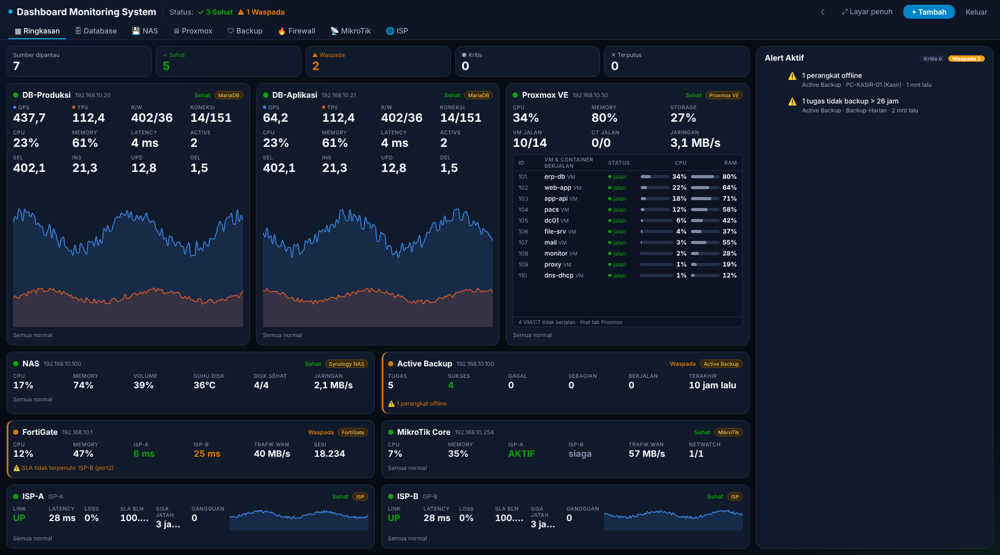
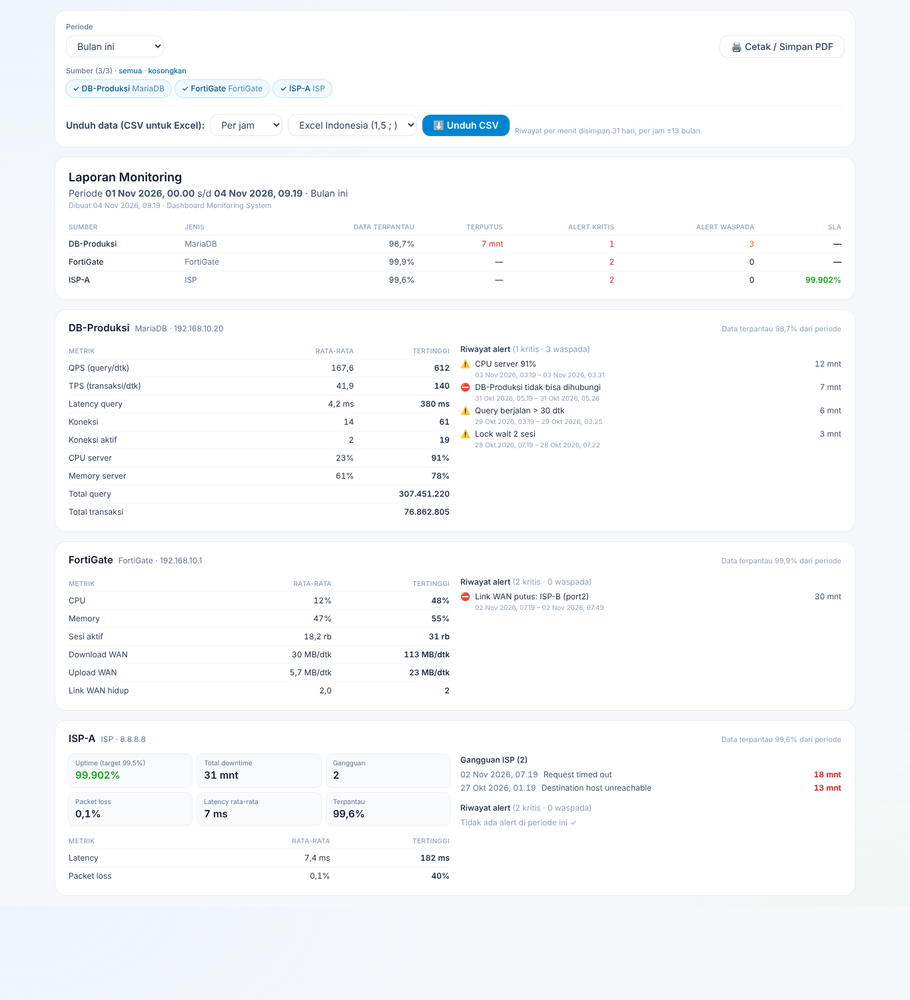
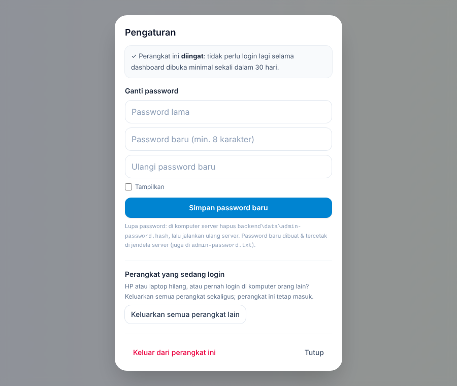
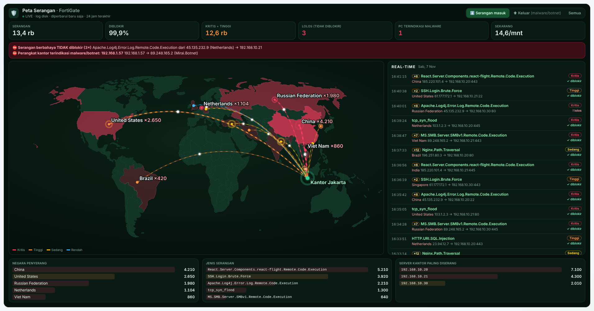

# Tutorial: Memasang Dashboard Monitoring System dari GitHub

Tutorial ini untuk **Windows** (komputer dashboard di kantor). Waktu yang dibutuhkan ±15 menit.
Panduan pemakaian lengkap ada di **[Panduan PDF](Panduan-Dashboard-Monitoring-System.pdf)**.

| Tampilan | |
|---|---|
|  |  |
| Tab Ringkasan (data contoh) | Tab Laporan (data contoh) |

---

## Daftar isi

1. [Yang dibutuhkan](#1-yang-dibutuhkan)
2. [Mengambil kode dari GitHub](#2-mengambil-kode-dari-github)
3. [Memasang & menjalankan otomatis](#3-memasang--menjalankan-otomatis)
4. [Login pertama & ganti password](#4-login-pertama--ganti-password)
5. [Menambah yang dipantau](#5-menambah-yang-dipantau)
6. [Memasang agen CPU & RAM di server database](#6-memasang-agen-cpu--ram-di-server-database)
7. [Update ke versi terbaru](#7-update-ke-versi-terbaru)
8. [Cadangan data](#8-cadangan-data)
9. [Akses dari luar kantor](#9-akses-dari-luar-kantor)
10. [Masalah yang sering terjadi](#10-masalah-yang-sering-terjadi)
11. [Untuk pengembang](#11-untuk-pengembang)

---

## 1. Yang dibutuhkan

| Di mana | Kebutuhan |
|---|---|
| **Komputer dashboard** (selalu menyala) | Windows 10/11 atau Windows Server 2016+, **[Node.js LTS](https://nodejs.org)** versi 22.13 atau lebih baru, koneksi internet saat instalasi pertama |
| **Server database** (opsional, untuk CPU/RAM) | Node.js 18+ |
| **Pengguna** | Browser apa saja (PC, laptop, HP) |

Pasang Node.js dengan semua pilihan bawaan, lalu pastikan berhasil. Buka **Command Prompt** dan ketik:

```bat
node -v
```

Harus muncul versi `v22.13.0` atau lebih baru (misalnya `v24.x`).

---

## 2. Mengambil kode dari GitHub

Repository ini **private**: Anda harus login GitHub dengan akun yang punya akses.

### Cara A — Download ZIP (paling mudah)

1. Buka halaman repository di GitHub.
2. Klik tombol hijau **Code → Download ZIP**.
3. Ekstrak ke folder tetap, misalnya `D:\dashboard-monitoring-system`.
   Hindari folder *Downloads* / *Desktop* yang sering dibersihkan.

### Cara B — Git (memudahkan update)

Pasang [Git for Windows](https://git-scm.com/download/win), lalu di Command Prompt:

```bat
cd /d D:\
git clone https://github.com/VBPNando/dashboard-monitoring-system.git
```

Saat diminta login, pilih *Sign in with your browser*.

---

## 3. Memasang & menjalankan otomatis

1. Buka folder hasil ekstrak/clone, klik dua kali **`menu.bat`**.
2. Muncul permintaan izin administrator → klik **Yes**.
3. Pilih **`1` — Pasang JALAN OTOMATIS**.
   - Instalasi pertama mengunduh paket & mem-build aplikasi (beberapa menit).
   - Setelah selesai muncul **BERHASIL** beserta alamat dashboard, misalnya `http://192.168.1.10:3000`.
4. Selesai. Server sekarang:
   - berjalan di latar belakang tanpa jendela,
   - menyala sendiri setiap Windows hidup (walau belum ada yang login),
   - dinyalakan ulang otomatis bila berhenti,
   - port-nya sudah dibuka di Windows Firewall.

Pilihan lain di `menu.bat`:

| Pilih | Fungsi |
|---|---|
| 1 | Pasang jalan otomatis |
| 2 | Hapus jalan otomatis |
| 3 / 4 | Nyalakan ulang / hentikan server |
| 5 | **Update** (build ulang setelah file diperbarui) |
| 6 / 7 | Buka dashboard / lihat log |
| 8 | Ganti port (bawaan 3000) |
| 9 | Reset password login (lupa password) |
| T | Jalankan di jendela ini (untuk melihat error) |

> Ingin memakai port lain (misalnya 3001)? Pilih **8** sebelum atau sesudah langkah 3.

---

## 4. Login pertama & ganti password

1. Buka alamat dashboard di browser.
2. Password pertama ada di file **`backend\data\admin-password.txt`** (buka dengan Notepad).
3. Biarkan **“Ingat saya”** tercentang → login. Perangkat ini tidak perlu login lagi selama dipakai minimal sekali sebulan.
4. Klik **⚙** di kanan atas → **Ganti password** → buat password Anda sendiri.



**Lupa password?** Di komputer dashboard: `menu.bat` → **9**. Password acak baru langsung ditampilkan.
Password lama tidak bisa dilihat kembali (disimpan sebagai hash).

---

## 5. Menambah yang dipantau

Klik **+ Tambah**, pilih jenis, isi formulir, klik **Tes koneksi**, lalu **Simpan**.
Selalu gunakan **akun khusus monitoring yang hanya-baca**.

| Jenis | Yang perlu disiapkan (ringkas) |
|---|---|
| **MariaDB / MySQL** | `CREATE USER 'dbmon'@'<subnet-dashboard>.%' IDENTIFIED BY '...'; GRANT PROCESS ON *.* TO 'dbmon'@'<subnet-dashboard>.%';` — kolom Database dikosongkan |
| **PostgreSQL** | `CREATE USER dbmon WITH PASSWORD '...'; GRANT pg_monitor TO dbmon;` + izinkan di `pg_hba.conf` |
| **SQL Server** | `CREATE LOGIN dbmon WITH PASSWORD='...'; GRANT VIEW SERVER STATE TO dbmon;` |
| **Proxmox VE** | API Token (hapus centang *Privilege Separation*) + role **PVEAuditor** di `/`. Port 8006 |
| **Proxmox Backup Server** | API Token + **API Token Permission** role **Audit** di `/`. Token ID `user@pbs!nama`. Port 8007 |
| **NAS Synology / Active Backup** | Akun grup administrators **tanpa 2FA**. Port 5001 |
| **FortiGate** | REST API Admin, profil read-only (+ **Log & Report: Read** untuk Peta Serangan), **PKI Group dimatikan**, Trusted Hosts = subnet dashboard. Isi API key |
| **MikroTik** | RouterOS **v7.1+**, aktifkan service `www`, user grup `read`. Beri *comment* pada default route tiap ISP |
| **ISP / SLA** | IP yang di-ping per ISP. Dua ISP di belakang firewall → target berbeda + Policy Route per ISP |

### Peta Serangan FortiGate



Buka tab **Firewall → 🛡 Peta Serangan**. Agar terisi, di FortiGate:

1. **System → Admin Profiles** → profil admin API → **Log & Report: Read**.
2. **Log & Report → Log Settings** → log ke **Disk** (bila ada) atau **Memory**.
3. **Policy & Objects → Firewall Policy**: di policy internet → server kantor (VIP/port-forward) dan LAN → internet,
   aktifkan **IPS** (dan Antivirus bila berlisensi) + **Log Allowed Traffic: Security Events**.
4. Tunggu ±1 menit.

Langkah lengkap dengan gambar menu tiap perangkat ada di **[Panduan PDF](Panduan-Dashboard-Monitoring-System.pdf)** (Bab 4, 6, 7).

---

## 6. Memasang agen CPU & RAM di server database

Database tidak memberikan CPU & RAM server lewat SQL, jadi dipasang agen kecil di **server database**.

1. Pasang Node.js LTS di server database.
2. Salin **hanya folder `agent`** dari repository ke server database (misalnya `C:\monitoring-agent`).
3. Klik dua kali **`menu-agent.bat`** → **Yes** → pilih **`1` — Pasang JALAN OTOMATIS**.
4. Catat **Agent URL** dan **Token** yang ditampilkan (bisa dilihat lagi lewat pilihan **5**).
5. Di dashboard: panel database → menu **⋯** → **Atur agen CPU & RAM** → isi → **Tes & simpan**.

---

## 7. Update ke versi terbaru

Daftar perangkat, password & riwayat ada di `backend\data` dan **tidak tersentuh** oleh update.

**Bila memakai Download ZIP**
1. Download ZIP terbaru dari GitHub.
2. Ekstrak dan **timpa** folder lama (pilih *Replace* semua).
3. `menu.bat` → **5 (Update)**.

**Bila memakai Git**
```bat
cd /d D:\dashboard-monitoring-system
git pull
```
lalu `menu.bat` → **5 (Update)**.

Setelah update, tekan **Ctrl + F5** di browser.

Agen di server database: salin folder `agent` versi baru (timpa, kecuali `agent-token.txt` tetap ada), lalu `menu-agent.bat` → **3**.

---

## 8. Cadangan data

Salin folder **`backend\data`** secara berkala (misalnya ke NAS). Isinya:

| File | Isi |
|---|---|
| `dbmon.sqlite` | Daftar perangkat (password terenkripsi) |
| `master.key` | **Kunci enkripsi — tanpa file ini password perangkat tidak bisa dibuka** |
| `admin-password.hash` / `.txt` | Password login |
| `metrics.sqlite`, `isp.sqlite` | Riwayat metrik, alert & SLA ISP |

> ⚠️ Folder `backend\data` berisi rahasia. **Jangan pernah meng-upload-nya ke GitHub** (sudah dikecualikan lewat `.gitignore`).

---

## 9. Akses dari luar kantor

Selain lewat VPN, dashboard bisa dibuka lewat domain dengan **Cloudflare Tunnel** tanpa membuka port router:

1. Cloudflare → **Networking → Tunnels → Create a tunnel** → Windows → jalankan perintah yang diberikan **di komputer dashboard**.
2. **Routes → Add route → Published application** → subdomain (mis. `monitor`), domain Anda, Service URL `http://localhost:3000` (sesuaikan port).
3. Sangat disarankan: lindungi dengan **Cloudflare Access** (izinkan email tertentu, One-time PIN).
4. Matikan **Rocket Loader** untuk domain tersebut.

Detail: Panduan PDF Bab 11.

---

## 10. Masalah yang sering terjadi

| Gejala | Solusi |
|---|---|
| `menu.bat` langsung tertutup / build gagal | Pastikan Node.js 22.13+ (`node -v`) dan ada internet; jalankan menu **T** untuk melihat pesan error |
| “port … sudah dipakai” | Jangan jalankan `start.bat` bersamaan dengan server latar; atau ganti port (menu **8**) |
| Bisa dibuka di komputer dashboard tapi tidak dari PC lain | Ulangi menu **1** (membuat aturan firewall); pastikan alamat IP:port benar |
| MariaDB “Host … is not allowed to connect” | User belum dibuat untuk IP/subnet komputer dashboard (Bagian 5) |
| CPU/Memory database tampil “—” | Agen belum dipasang/terhubung (Bagian 6) |
| FortiGate 401 | API key salah atau IP dashboard tidak ada di Trusted Hosts |
| MikroTik 404 | RouterOS masih v6 atau service `www` mati |
| Lupa password | `menu.bat` → **9** |

Daftar lengkap: Panduan PDF Bab 12.

---

## 11. Untuk pengembang

```bash
# Backend (API di :3000)
cd backend && npm install && npm run dev
# Frontend (UI di :5173, proxy ke :3000)
cd frontend && npm install && npm run dev
```

- Teknologi: Node.js 22 + TypeScript, Fastify, Socket.IO, SQLite bawaan Node (`node:sqlite`), React + Vite + Tailwind CSS v4, ECharts.
- Struktur & arsitektur: lihat [README](../README.md).
- Pengaturan opsional: salin `backend/.env.example` menjadi `backend/.env`.
- **Jangan commit** `backend/data/`, `.env`, `agent/agent-token.txt` (sudah ada di `.gitignore`).
